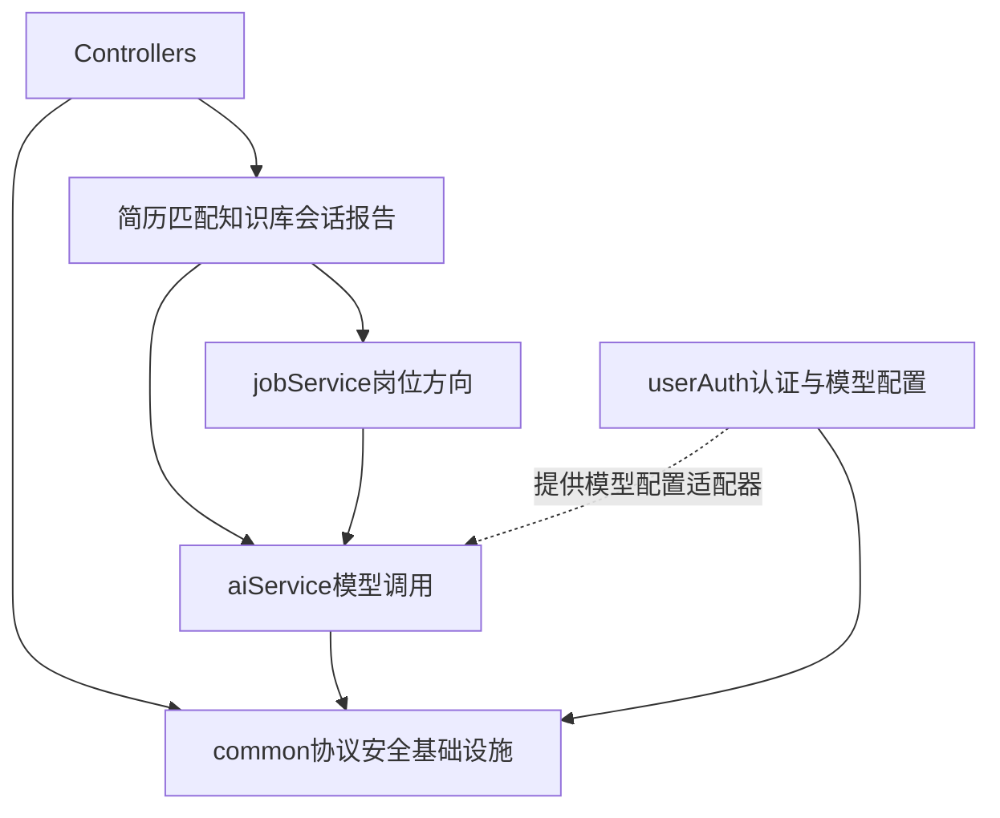

# 多模型路由

业务代码不注入全局 `ChatClient` / `ChatModel`。文本、结构化和流式调用走 `aiService` 的 `ModelGateway`。用户认证模块只保存模型配置并加密密钥。Embedding 仍用 Spring AI 自动装配的 `EmbeddingModel`。

---

## 模块职责

```
com.zdmj.aiService
  api/ModelGateway                  # generate / generateStructured / stream
  api/ModelRequest                  # 单次文本
  api/StructuredModelRequest        # 结构化；platformModel 非空时忽略用户配置
  api/StreamingModelRequest         # 带会话标识的流式输出
  model/ModelCode                   # 可选模型目录（code → baseUrl + apiModelName）
  provider/UserModelConfigurationProvider
  service/ModelGatewayImpl          # 提示词、缓存、结构化输出、流式调用
  config/ModelClientConfiguration   # 超时、平台密钥、供应商 HTTP 客户端

com.zdmj.userAuthService
  llm/UserApiKeyCipher              # Encryptors.text；缺密钥启动失败
  service/impl/UserModelConfigurationProviderImpl
                                    # 读 user_llm_config 并解密，不构建客户端

com.zdmj.knowledgeService.config
  RagConfig                         # 改写开关、topK、相似度、上下文预算
  EmbeddingConfig                   # Token 切分

com.zdmj.conversationService.config
  ChatModelConfig                   # JDBC ChatMemory，窗口 40 条

com.zdmj.common.prompt
  PromptLoader                      # 受限制的 classpath 文件读取与缓存

com.zdmj.jobService.api
  JobRole / JobRoleDetectionService / JobRoleDetectionResult
com.zdmj.jobService.service.impl
  JobRoleDetectionServiceImpl        # 方向识别，通过 ModelGateway 调用模型

各业务模块维护自身提示词路径常量。
```

`ModelRequest`、`StructuredModelRequest`、`StreamingModelRequest` 构造时复制 `promptVars`，通过不可修改的映射保存；保留 `null` 映射及空值，映射中的变量对象由调用方保证稳定。认证及模型配置数据的密码、验证码、密钥和登录令牌排除在自动生成的 `toString()` 之外，HTTP 序列化契约保持一致。



`aiService` 不访问 `UserLlmConfigMapper`、`UserLlmConfig` 和用户表。Spring 在启动时把用户认证模块的实现装配到查询端口：

```java
public interface UserModelConfigurationProvider {
    ResolvedModelConfiguration resolve(CurrentActor actor);
}
```

该端口只解析当前用户保存的模型与解密后的密钥；没有记录时返回空配置，由网关决定平台兜底。平台模型调用直接读取平台配置，不经过该端口。查询结果禁止写入日志、响应或缓存；`toString()` 不包含密钥。

---

## 调用方式

| 场景 | 方法 |
| --- | --- |
| 单次文本 | `generate(actor, ModelRequest)` |
| 结构化 JSON | `generateStructured(actor, StructuredModelRequest.of(...))` |
| 简历识别 | `resumeImportModel()` 后 `StructuredModelRequest.platform(...)` |
| SSE 多轮 / RAG | `stream(actor, StreamingModelRequest)` |

用户主键为空时抛 `USER_NOT_LOGIN`（2010 以外的未登录码）。异步消费者用任务记录里的 `user_id` 构造 `CurrentActor`，不必写入 ThreadLocal。见 [`llm-async-stream.md`](llm-async-stream.md)。

结构化调用在请求级设置 `response_format=json_object`，并用 `ChatClient.entity()` 解析。Schema 由框架追加到用户消息。解析失败直接抛出异常。不使用 `json_schema`（DeepSeek 会返回 400）。提示词只替换 `${key}` 与 `{key}`。

---

## 路由决策

用户对话：

```
UserModelConfigurationProvider.resolve(actor)
  ├─ 已配置 → ModelCode.fromCode + 解密后的密钥
  └─ 未配置
        ├─ 关闭 platform-fallback → 2010
        ├─ 平台 API Key 为空 → 2010
        └─ 否则 → spring.ai.openai.{base-url, api-key, chat.options.model}
```

简历识别忽略用户配置：已配置 `DEEPSEEK_API_KEY` 时用 `DEEPSEEK_FLASH`，否则在平台密钥可用时用 `QWEN_PLUS`（`qwen3.8-flash`），不跟随平台默认 Max。DeepSeek 平台模型使用 `DEEPSEEK_API_KEY`，通义平台模型使用 `SPRING_AI_OPENAI_API_KEY`。

### 模型目录（`ModelCode`）

| code | 展示名 | baseUrl | API 模型名 |
| --- | --- | --- | --- |
| `qwen3.8-flash` | 通义千问 3.8 Flash | DashScope compatible-mode | `qwen3.8-flash` |
| `qwen3.8-max` | 通义千问 3.8 Max | 同上 | `qwen3.8-max` |
| `deepseek-v4-flash` | DeepSeek V4 Flash | `https://api.deepseek.com` | `deepseek-v4-flash` |
| `deepseek-v4-pro` | DeepSeek V4 Pro | 同上 | `deepseek-v4-pro` |

非法 code → `USER_LLM_CONFIG_INVALID`（2011）。读库时兼容旧 code：`qwen3.6-plus` → Flash，`qwen3.7-max` → Max。

---

## 客户端缓存

| 出口 | 缓存键 | Advisor | 场景 |
| --- | --- | --- | --- |
| 用户文本 / 结构化 | `{userId}:plain` | 无 | 画像、匹配、图谱、报告、标题、查询改写 |
| 流式 | `{userId}:memory` | `MessageChatMemoryAdvisor` | 多轮对话 / RAG 答疑 |
| 平台模型 | `platform:{code}` | 无 | 简历识别 |

会话记忆由 `conversationService` 提供 JDBC 仓库和 40 条窗口。调用方传入会话标识后，网关把 `CONVERSATION_ID` 设为该主键。删除会话时 `ChatMemory.clear(id)`。

保存或删除用户配置后，用户认证模块调用 `ModelGateway.evict`。平台客户端在进程内缓存，密钥变更后需重启。

超时：业务连接 10s / 读 300s；连通性探测 5s / 30s 且 `maxTokens=1`。`qwen3*` 写入 `enable_thinking=false`，`deepseek-v4*` 写入 `thinking.type=disabled`。

baseUrl 已以 `/v1`、`/v4` 等结尾时，显式设置 `completionsPath("/chat/completions")`，避免拼出重复版本号。当前目录中的 DashScope 与 DeepSeek 地址都不含版本号。

---

## 配置与接口

| Key | 默认 | 含义 |
| --- | --- | --- |
| `app.ai.user-llm.platform-fallback-enabled` | `true` | 无用户配置时允许平台 Key |
| `app.ai.user-llm.encryption-key` | 空 | 偶数位 hex；缺则启动失败 |
| `app.ai.deepseek.api-key` | 空 | 平台 DeepSeek |
| `spring.ai.openai.*` | DashScope + `AL_MODEL` | 平台 Chat / Embedding |

| 方法 | 路径 | 说明 |
| --- | --- | --- |
| GET | `/users/llm-config` | 未配置时 `configured=false`，`usingPlatformDefault` 反映兜底开关 |
| GET | `/users/llm-config/models` | 目录列表 |
| PUT | `/users/llm-config` | 保存后 `evict` |
| DELETE | `/users/llm-config` | 删除后回落平台（若允许） |
| POST | `/users/llm-config/test` | 用请求体探测，不读库、不写缓存 |

错误码：2010 未配置（428），2011 配置非法（400），2012 / 2013 加解密失败（400），2014 连通性探测失败（400）。

知识库向量使用 `text-embedding-v4`、1024 维，不跟随用户 Chat Key。查询改写、检索数量和相似度在 `knowledgeService`。
