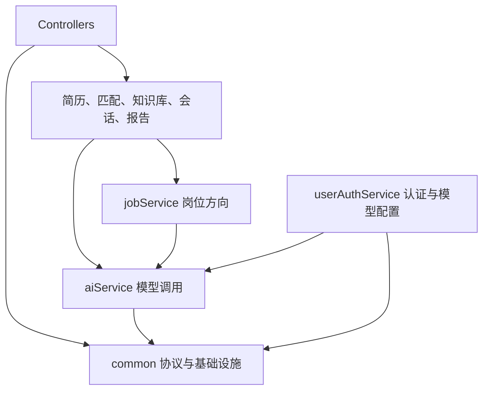

# `common` 边界重构方案

本文规定 `common` 边界重构的最终结构、依赖方向、迁移顺序和验收条件。本阶段保持 HTTP 契约、错误码、数据库结构及现有异步状态迁移和 ACK 行为不变。

## 范围

- 纠正 `common` 对业务模块的反向依赖。
- 将业务类型、业务配置、业务缓存和模型调用能力迁入明确的所有者模块。
- 删除 `UserHolder`、静态 JWT 密钥和静态时钟等全局状态。
- 统一身份显式传递、时间注入、配置校验和远程调用事务边界。
- 固定现有异步运行时的位置，不改变入队、消费、失败和 ACK 语义。
- 测试安全网按 [`testing-safety-net-plan.md`](testing-safety-net-plan.md) 执行。

本阶段不引入新的观测组件，不实施数据库任务队列、租约、重试和死信机制。

## 目标依赖



- `common` 不依赖任何业务模块。
- `aiService` 不依赖业务模块的 Entity、Mapper、实现类和内部 DTO。
- `userAuthService` 实现 `aiService` 定义的模型配置查询端口。
- 业务模块通过公开接口协作，不访问其他模块的持久化实现。

## `common` 最终结构

```text
common/
├── api/           # Result、PageDTO
├── exception/     # ErrorCode、BusinessException、Problem Details
├── security/      # CurrentActor、JWT、Session Store、认证过滤器
├── persistence/   # BaseEntity、JSONB TypeHandler、MyBatis 配置
├── web/           # CurrentActor 参数解析器、Web 配置
├── time/          # Clock 配置
├── storage/       # 对象存储及受约束的对象引用
├── prompt/        # classpath 提示词文件加载器
├── ratelimit/     # 限流注解与基础实现
└── async/         # 行为冻结的现有异步运行时
```

`common` 只保留稳定、无单一业务归属且被多个模块实际使用的能力。迁移完成后清空通用 `util` 包，剩余类型使用职责名称归入对应包。

## 模型调用与用户配置

新增 `aiService`，负责：

- 模型路由与供应商适配。
- 单次文本、结构化结果和流式输出。
- 通用模型连接、超时和客户端配置。
- Embedding 调用接口。
- 按调用方传入的会话标识访问会话记忆。

公开接口保持精简：

```java
public interface ModelGateway {
    String generate(CurrentActor actor, ModelRequest request);
    <T> T generateStructured(CurrentActor actor, StructuredModelRequest<T> request);
    Flux<String> stream(CurrentActor actor, StreamingModelRequest request);
}

public interface EmbeddingGateway {
    List<float[]> embed(CurrentActor actor, List<String> texts);
}
```

`aiService` 定义 `UserModelConfigurationProvider` 查询端口，`userAuthService` 提供实现并继续拥有 `user_llm_config`、用户模型配置 CRUD 和 API Key 加密存储。查询结果为短生命周期的不可变对象，禁止记录密钥、序列化到响应或写入缓存。

```java
public interface UserModelConfigurationProvider {
    ResolvedModelConfiguration resolve(CurrentActor actor);
}
```

当前归属：

- 模型选择、模型调用、结构化输出、流式调用和供应商适配在 `aiService`。
- `UserApiKeyCipher` 与用户模型配置在 `userAuthService`。
- `RagConfig`、查询改写、检索数量、相似度阈值和重排参数在 `knowledgeService`。
- 会话标识和会话记忆使用规则在 `conversationService`。

## 岗位方向与提示词

- `JobRole` 迁入 `jobService.api`，作为稳定的岗位方向公开类型。
- `jobService.api.JobRoleDetectionService` 提供方向识别，返回 `JobRoleDetectionResult`；岗位模块内部实现调用 `ModelGateway` 并校验模型输出。
- `aiService` 不认识 `JobRole`，只处理通用请求和结构化返回类型。
- 各业务模块通过自己的提示词路径表达调用场景，路径常量由实际使用模块维护。可观测性通过调用链和业务操作标识记录场景。
- `common.prompt.PromptLoader` 只允许读取 `classpath:/prompts/`，拒绝绝对路径、`..` 和外部 URL；文件缺失时立即终止。未知方向明确选择 `default` 模板。
- 方向识别的模型调用失败、非法方向及非法置信度直接传播；具体规则见 [`job-role-prompt.md`](job-role-prompt.md)。

## 身份边界

新增不可变的 `CurrentActor`：

```java
public record CurrentActor(Long userId, ActorOrigin origin) {
    public CurrentActor {
        if (userId == null || userId <= 0) {
            throw new IllegalArgumentException("userId 必须为正数");
        }
    }
}

public enum ActorOrigin {
    HTTP,
    ASYNC_TASK
}
```

- `JwtAuthenticationFilter` 验证令牌和 Session 后，将 `CurrentActor` 写入 `SecurityContext`。
- `HandlerMethodArgumentResolver` 将认证主体解析为 Controller 参数。
- Controller 将 `CurrentActor` 显式传给应用服务。
- Mapper 只接收查询所需的 `userId`，领域对象不保存 `CurrentActor`。
- Reactor 回调、线程池、`@Async` 和 Redis Stream 消费过程显式传递身份，禁止临时读取请求线程上下文。
- `RateLimitAspect` 从方法参数或认证主体取得身份，不访问线程容器。
- 全部调用点迁移后删除 `UserHolder`，不保留双重身份读取方式。

异步消费者只信任数据库任务行中的 `userId`：

```text
Redis 消息中的任务标识符
→ 查询数据库任务
→ CurrentActor(userId, ASYNC_TASK)
→ AsyncTaskExecutor.execute(actor, task)
```

消息中的用户标识不得作为授权依据，也不再构造虚假用户名。

## JWT 与时间

- `JwtUtil` 改为 `common.security.JwtTokenService` 实例服务。
- JWT 密钥、有效期和 `Clock` 通过构造器注入；密钥缺失、过短或格式错误时启动失败。
- JWT 只保存稳定身份字段，不保存模型配置或可变业务资料。
- `TimeConfiguration` 提供唯一的 `Clock` Bean。
- JWT、MyBatis 自动填充、用户服务和报告服务注入同一 `Clock`。
- 全部调用点迁移后删除 `DateTimeUtil.bind` 及静态时钟。

## Redis、缓存与异步运行时

- 验证码 Key 和操作迁入 `userAuthService`。
- 岗位详情 Key、缓存读取和缓存写入迁入 `jobService`。
- JWT Session Key 留在 `RedisJwtSessionStore` 附近。
- 删除 `RedisUtil` 中通用缓存方法。
- Stream 操作收缩为 `common.async.redis.RedisStreamClient`，只暴露现有运行时需要的追加、读取和 ACK 操作。
- 本阶段不新增业务 Stream；后续启用数据库任务队列时删除该 Stream 接口。

中央 `AsyncTaskType`、先插入数据库再执行 `XADD`、固定消费者名称、失败后写入 `FAILED` 并 ACK 等行为保持现状。知识库向量化继续使用现有 Stream。

## 对象存储与文本提取

- 对象存储继续位于 `common.storage`，接口接收 `CurrentActor` 和受约束的对象分类值。
- 对象键由存储组件生成，调用方不得传入任意用户前缀、绝对路径或包含路径分隔符的分类值。
- 删除操作验证对象键属于当前用户。
- 文本提取器只接收存储组件签发的 `StoredObjectRef` 或可信输入流，不接收任意远程 URL。
- `zdmj.storage.mode=cos` 时校验 Secret ID、Secret Key、Region 和 Bucket，任一缺失则启动失败。
- `local` 模式不创建 COS 客户端；未知存储模式直接终止启动；日志不得包含密钥。

## 事务边界

模型、对象存储和其他远程调用在数据库事务外执行。应用服务负责流程编排，独立写入组件负责短事务保存：

```text
读取并校验输入
→ 调用远程能力
→ 开启短事务
→ 再次校验资源归属与输入版本
→ 保存结果
```

事务写入方法放在独立 Spring Bean，避免同类方法调用绕过事务代理。可能在远程调用期间变化的数据使用版本、更新时间或内容摘要进行并发校验。

会话流式流程使用三个阶段：

```text
短事务保存用户消息和助手占位消息
→ 提交后启动模型流
→ 流结束后以短事务保存最终内容和状态
```

模型流失败或客户端中断时，以短事务记录明确状态并输出既有 SSE 错误契约。禁止在事务方法内手工 `subscribe()`，禁止在整个流生命周期持有数据库连接。

## ErrorCode

`ErrorCode` 留在 `common`，已有编号和 HTTP 映射保持不变。新增错误码按模块编号范围管理，并由自动化测试检查编号唯一性和关键 HTTP 映射。`common` 不得通过错误码引用业务类型。

## ArchUnit 规则

本阶段结束时启用严格规则：

- `common` 不依赖任何业务模块或 `aiService`。
- `aiService` 不依赖业务模块的 Entity、Mapper、实现类和内部 DTO。
- Controller 不直接访问 Mapper。
- 业务模块不访问其他模块的 Mapper、Entity 和 `service.impl`。
- 模块之间不存在新增循环依赖。

`common` 相关冻结条目在本阶段全部删除。其他既有跨模块依赖可以继续冻结并禁止新增，在对应模块边界任务完成后逐项删除。CI 禁止自动更新 ArchUnit 冻结记录。

## 实施顺序

岗位方向、识别服务及提示词职责迁移已完成，`common.ai` 已清空。后续从第六项 Redis 职责拆分继续。

1. 运行测试安全网并保存基线结果。
2. 新增 `CurrentActor`、`JwtTokenService` 和统一 `Clock`，暂不删除旧入口。
3. 新增 `aiService` 公开接口、模型配置查询端口和实现。
4. 按模块将模型调用迁移到 `ModelGateway`。
5. 迁移岗位方向、提示词常量、RAG 配置和用户密钥实现，清空 `common.ai`。
6. 迁移验证码、岗位缓存和 JWT Redis Key，收缩 `RedisUtil`。
7. 按模块将 Controller 和应用服务切换为显式 `CurrentActor`。
8. 修改 Reactor、异步执行器、限流、存储和文本提取的身份传递。
9. 删除 `UserHolder`，迁移时间调用后删除静态时钟。
10. 拆分远程调用编排与事务写入组件，单独处理会话流式流程。
11. 启用严格的 `common` ArchUnit 规则并删除相关冻结条目。
12. 删除所有编译适配器、无调用代码和临时忽略项，执行完整验收。

实施过程中可以使用短期编译适配器维持连续迁移；最终提交状态不得保留两套模型调用、身份读取或时间访问方式。

## 后续阶段

- 异步重构：删除中央业务类型清单，改为模块注册执行器；使用数据库任务队列、租约、心跳、明确状态机、幂等和受控重试。
- 可观测性重构：为模型调用、对象存储和异步消费增加结构化日志，统一关联 `traceId` 与 `operationId`。
- Agent 重构：Python 使用 LangGraph 管理 Agent 状态，通过 Java Tool Gateway 访问业务能力；该阶段不改变本文规定的 Java 模块边界。

## 验收

- `./mvnw -B -ntp clean verify` 通过，Surefire、Failsafe、JaCoCo 和 ArchUnit 均无失败。
- `common` 对业务模块和 `aiService` 的依赖数量为零。
- HTTP 状态、错误码、JSON 字段、SSE 事件、数据库结构及异步状态迁移保持兼容。
- 不存在 `UserHolder`、静态 JWT 密钥、静态 `Clock`、通用业务缓存方法和跨模块 Mapper 访问新增项。
- 模型和存储配置在应用启动时完成校验，敏感配置不出现在日志、响应和测试报告中。
- 远程调用不持有数据库事务，会话流式调用不存在事务内手工订阅。
- 文档、代码、测试、配置和 ArchUnit 规则反映同一套最终结构。
